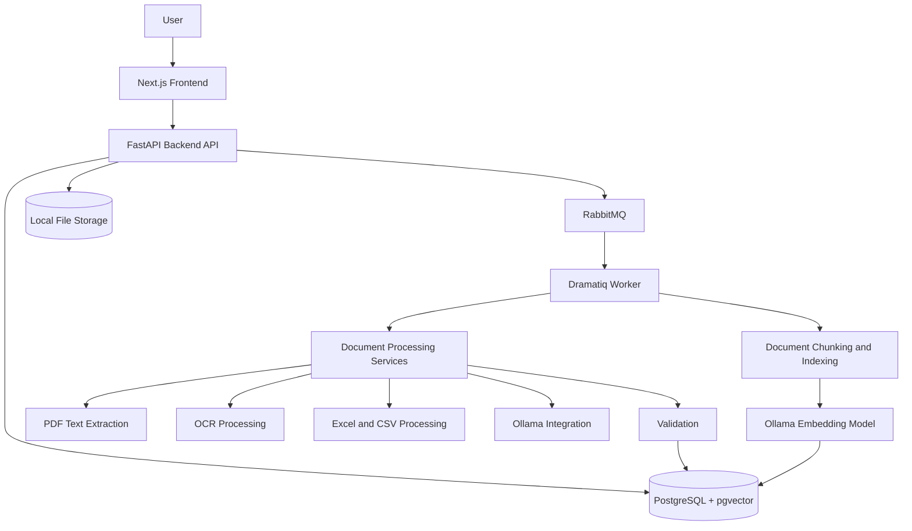

# System Architecture

## Overview

The AI-Powered Document Intelligence System uses a frontend, backend API, relational database, background task queue, document-processing services, and local AI services.

## Architecture Diagram

## Component Responsibilities

### Frontend
- Built with Next.js, React, and TypeScript.
- Provides the user interface for document submission and displaying processing results.

### Backend API
- Built with Python and FastAPI.
- Handles document uploads, verification, search, corrections, retries, and document retrieval.

### Database
- PostgreSQL stores document information, extracted invoice data, processing jobs, validation issues, and verification results.
- pgvector stores document embeddings for semantic search.

### Background Processing
- RabbitMQ provides message delivery.
- Dramatiq workers execute document-processing and indexing tasks asynchronously.

### Document Processing
- PyMuPDF handles PDF text extraction.
- Tesseract OCR and image-processing libraries support scanned documents and images.
- pandas, openpyxl, and xlrd support spreadsheet processing.
- Python validation logic checks extracted information.

### AI Integration
- Ollama provides local model inference and text embeddings.
- The configured models are `qwen3-vl:4b-instruct` and `nomic-embed-text`.

## Processing Workflow

1. The user submits documents through the frontend.
2. The FastAPI backend receives and stores uploaded files.
3. Document-processing tasks are dispatched through RabbitMQ.
4. Dramatiq workers process the documents using the relevant extraction pipeline.
5. Extracted information and validation results are stored in PostgreSQL.
6. Document content is divided into chunks and indexed using embeddings.
7. Users can retrieve document details, processing status, search results, and verification results through the API.

## Local Deployment

The application runs locally with separate frontend and backend processes. PostgreSQL, RabbitMQ, Ollama, and Tesseract OCR provide supporting services.

