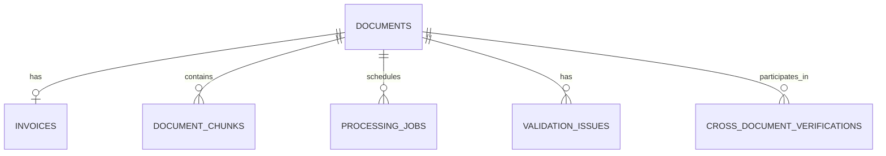

# Database Schema Overview

The application uses PostgreSQL with SQLAlchemy ORM models. The pgvector extension supports vector-based semantic search.

## 1. Documents

**Table:** `documents`

Stores uploaded document information and processing results.

Key fields:
- `document_id` - Primary key
- `filename` - Original filename
- `stored_path`  Stored file location
- `file_type` - File format
- `document_type` - Document type
- `document_category` - Document category
- `processing_status` - Current processing status
- `file_size_bytes` - File size
- `extracted_text` - Extracted document text
- `extraction_result` - Extraction results
- `ai_extraction` - AI extraction results
- `validation_result` - Validation results
- `created_at`, `updated_at` - Timestamps

## 2. Invoices

**Table:** `invoices`

Stores structured invoice information.

Key fields:
- `id` - Primary key
- `document_id` - Foreign key referencing `documents.document_id`
- `invoice_number`
- `invoice_date`
- `due_date`
- `supplier`
- `customer`
- `currency`
- `subtotal`
- `tax_rate`
- `tax_amount`
- `total`
- `line_items`
- `requires_review`
- `review_reasons`
- `created_at`

Each invoice record is associated with one document.

## 3. Document Chunks

**Table:** `document_chunks`

Stores text chunks and vector embeddings for semantic search.

Key fields:
- `id` - Primary key
- `document_id` - Foreign key referencing `documents.document_id`
- `chunk_index` - Chunk sequence number
- `content` - Text content
- `embedding` - 768-dimensional vector
- `created_at`

A unique constraint prevents duplicate chunk indexes for the same document.

## 4. Processing Jobs

**Table:** `processing_jobs`

Tracks background processing tasks.

Key fields:
- `job_id` - Primary key
- `document_id` - Foreign key referencing `documents.document_id`
- `task_id` - Background task identifier
- `status` - Job status
- `retry_count`
- `max_retries`
- `error_message`
- `created_at`
- `started_at`
- `completed_at`

## 5. Validation Issues

**Table:** `validation_issues`

Stores validation findings associated with documents.

Key fields:
- `id` - Primary key
- `document_id` - Foreign key referencing `documents.document_id`
- `error_code`
- `severity`
- `field_name`
- `message`
- `details`
- `created_at`

## 6. Cross-Document Verifications

**Table:** `cross_document_verifications`

Stores verification results involving two documents.

Key fields:
- `verification_id` - Primary key
- `document_1_id` - Foreign key referencing `documents.document_id`
- `document_2_id` - Foreign key referencing `documents.document_id`
- `document_category`
- `verification_status`
- `verification_result`
- `created_at`

## Entity Relationship Diagram

**Note:** Each cross-document verification references two document records. This diagram is a simplified overview of the model relationships.